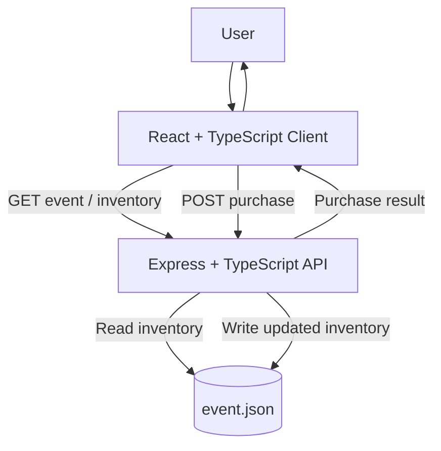

# Design: Golden Ticket Drop

## 1. Architecture Diagram

The frontend (React + TypeScript) client communicates with the backend (Express + TypeScript API) over HTTP. The API reads and updates inventory stored in a JSON file.

### Purchase flow

1. The client requests event details and available tickets.
2. The user clicks Buy.
3. The client sends a purchase request to the API. (The client sends a POST request to the API with the ticket quantity. The quantity is currently set to 1, meaning each purchase buys one ticket. The implementation supports purchasing multiple tickets in a single request in the future.)
4. The API checks availability and updates inventory.
5. The API returns the purchase result and remaining ticket count.
6. The client displays the confirmation or an error message.

## 2. Concurrency Strategy

The backend uses an in-memory `ConcurrencyLock` to prevent concurrent requests from overselling the ticket inventory.

For each purchase:

1. Acquire the lock before reading inventory.
2. Read the latest ticket count from `event.json`.
3. Check whether enough tickets are available.
4. Decrease the ticket count.
5. Save the updated inventory.
6. Release the lock in a `finally` block.

This ensures that purchase requests processed one at a time.

For example, if two users attempt to purchase the last available ticket simultaneously:

- User A acquires the lock first and purchases the ticket.
- User B waits until User A finishes.
- User B then reads the updated inventory and receives a SOLD_OUT response.

This prevents the inventory from becoming negative, provided all inventory updates use the same lock.

**Limitation:** An in-memory lock only protects a single Node.js process.

## 3. Scalability

If traffic increased to 1 million users, I would replace JSON file storage and the in-memory lock with a shared database.

The database would handle inventory updates using database transactions. The query directly updates the inventory fields and returns the updated stock quantity, which determines whether the purchase was successful or the tickets are sold out.
